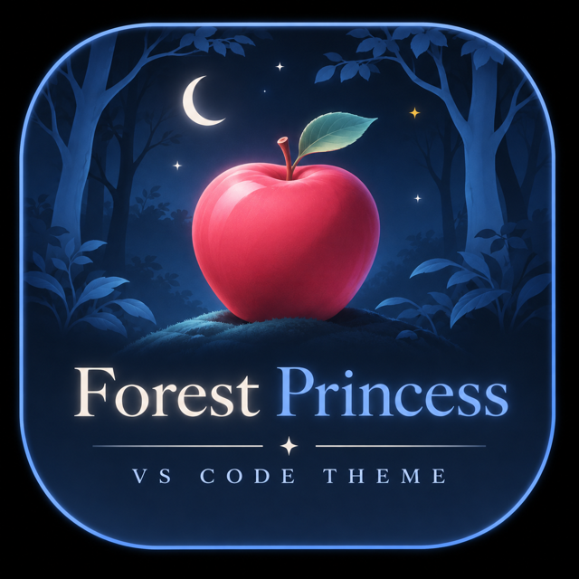
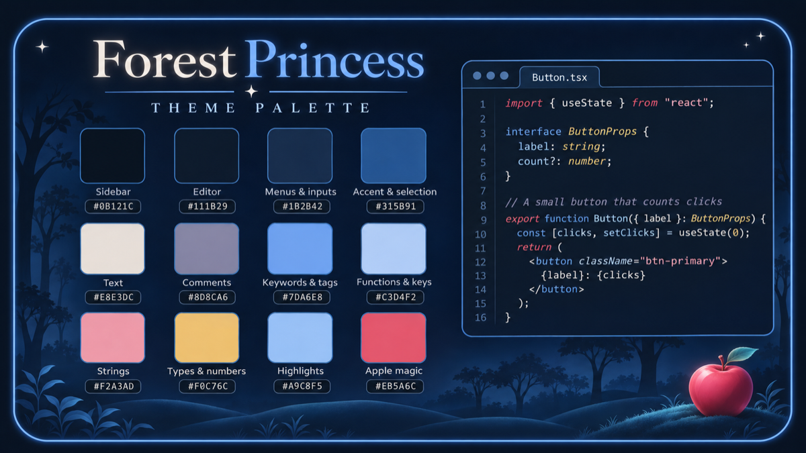

<p align="center"></p>

# Forest Princess

A dark VS Code theme with enchanted-forest night, a royal blue bodice, a poisoned red apple and a golden skirt.

## Palette

<p align="center"></p>

<!-- palette:start -->
| Role | Color |
| --- | --- |
| Sidebar and panels | `#0b121c` |
| Editor background | `#111b29` |
| Menus, inputs and widgets | `#1b2b42` |
| UI accent (selection, buttons) | `#315b91` |
| Text | `#e8e3dc` |
| Comments | `#8d8ca6` |
| Keywords, operators, tags | `#7da6e8` |
| Functions, keys, attributes | `#c3d4f2` |
| Strings | `#f2a3ad` |
| Types, numbers, constants, cursor | `#f0c76c` |
| Highlights and links | `#a9c8f5` |
| Apple red: control flow, this, regex, active icon, badges | `#eb5a6c` |
<!-- palette:end -->

## Install

Search for **Forest Princess** in the Extensions view, or run:

```
code --install-extension thaisemanuele.forest-princess
```
